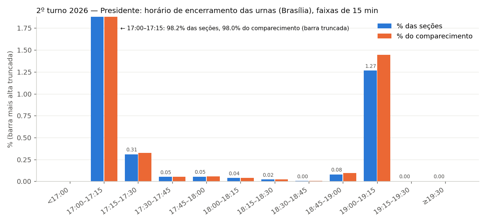
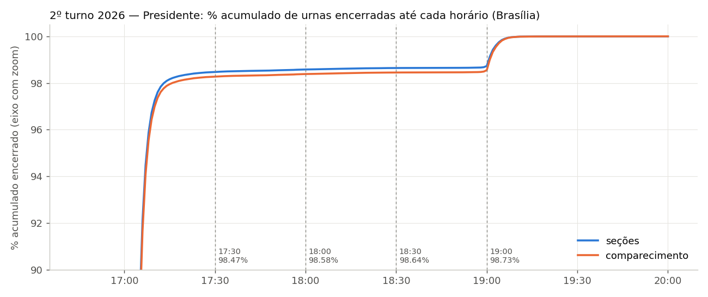

# Horário de encerramento das urnas e simulações de corte — Eleição Ordinária Federal - 2026 2º Turno — Presidente

Eleição 6258 (pleito 3221), 25/10/2026. UFs no relatório: 28 (AC, AL, AM, AP, BA, CE, DF, ES, GO, MA, MG, MS, MT, PA, PB, PE, PI, PR, RJ, RN, RO, RR, RS, SC, SE, SP, TO, ZZ).

Fonte: Boletins de Urna (arquivo `-bu.dat`, ASN.1/DER) publicados em resultados.tse.jus.br, campo `dataHoraEncerramento` do BU, normalizado para o horário de Brasília. Detalhes de método e limitações no fim do documento. Dados por seção em `dados/secoes_*.parquet`.

## Resumo

- Seções com BU processadas: **499.248**; com horário de encerramento: **499.178**; seções agregadas (votos no BU da seção principal): 17.931.
- Urnas encerradas (Brasil, % das seções): até 17:30 **98.47%**, até 18:00 **98.58%**, até 18:30 **98.64%**, até 19:00 **98.73%**; depois das 19:00: **1.27%** (6.352 seções).
- Vencedor com todas as urnas: **LULA (13)** (51.79% dos válidos, margem 4.430.099 votos). **O vencedor não muda** em nenhum dos 4 cortes.

## Validação: soma dos BUs × resultado oficial do TSE

Oficial TSE Brasil (totalização de 25/10/2026 23:26:38; seções totalizadas 499248 de 499248):

| Brasil | LULA | FLAVIO BOLSONARO | brancos | nulos | comparecimento |
|---|---:|---:|---:|---:|---:|
| soma dos BUs | 64.255.787 | 59.825.688 | 1.430.484 | 2.723.284 | 128.235.243 |
| oficial TSE | 64.256.232 | 59.826.041 | 1.430.496 | 2.723.305 | 128.236.074 |
| diferença | -445 | -353 | -12 | -21 | -831 |

**Não bate exatamente** — ver diferença acima e seções com problema abaixo.

Por UF

| UF | LULA | FLAVIO BOLSONARO | brancos | nulos | comparec. | diferença BU−oficial (LULA, FLAVIO BOLSONARO, br, nu, comp) |
|---|---:|---:|---:|---:|---:|---:|
| AC | 144.513 | 287.715 | 5.016 | 16.410 | 453.654 | +0, +0, +0, +0, +0 |
| AL | 1.152.621 | 744.140 | 16.983 | 37.888 | 1.951.632 | +0, +0, +0, +0, +0 |
| AM | 1.145.783 | 975.245 | 18.324 | 52.707 | 2.192.059 | +0, +0, +0, +0, +0 |
| AP | 222.968 | 198.674 | 3.320 | 5.013 | 429.975 | +0, +0, +0, +0, +0 |
| BA | 6.485.258 | 2.608.761 | 92.721 | 235.307 | 9.422.047 | +0, +0, +0, +0, +0 |
| CE | 4.036.124 | 1.819.478 | 56.386 | 112.855 | 6.024.843 | +0, +0, +0, +0, +0 |
| DF | 825.224 | 979.542 | 22.386 | 41.128 | 1.868.280 | +0, +0, +0, +0, +0 |
| ES | 1.001.965 | 1.294.504 | 33.080 | 79.665 | 2.409.214 | +0, +0, +0, +0, +0 |
| GO | 1.585.555 | 2.345.334 | 43.214 | 73.177 | 4.047.280 | +0, +0, +0, +0, +0 |
| MA | 2.808.231 | 1.229.971 | 30.855 | 58.714 | 4.127.771 | +0, +0, +0, +0, +0 |
| MG | 6.351.099 | 6.241.786 | 164.141 | 287.177 | 13.044.203 | +0, +0, +0, +0, +0 |
| MS | 628.973 | 927.892 | 14.958 | 22.637 | 1.594.460 | +0, +0, +0, +0, +0 |
| MT | 694.167 | 1.351.099 | 15.431 | 24.637 | 2.085.334 | +0, +0, +0, +0, +0 |
| PA | 2.690.449 | 2.199.940 | 36.501 | 62.683 | 4.989.573 | +0, +0, +0, +0, +0 |
| PB | 1.794.059 | 865.210 | 25.943 | 58.348 | 2.743.560 | +0, +0, +0, +0, +0 |
| PE | 4.117.513 | 1.832.554 | 56.758 | 119.642 | 6.126.467 | +0, +0, +0, +0, +0 |
| PI | 1.653.989 | 525.859 | 16.137 | 43.845 | 2.239.830 | +0, +0, +0, +0, +0 |
| PR | 2.566.504 | 4.291.444 | 82.572 | 118.819 | 7.059.339 | +0, +0, +0, +0, +0 |
| RJ | 4.565.393 | 5.169.033 | 111.682 | 231.341 | 10.077.449 | +0, +0, +0, +0, +0 |
| RN | 1.413.596 | 737.409 | 19.939 | 61.879 | 2.232.823 | +0, +0, +0, +0, +0 |
| RO | 294.446 | 674.382 | 8.361 | 11.300 | 988.489 | +0, +0, +0, +0, +0 |
| RR | 83.505 | 219.675 | 2.176 | 3.241 | 308.597 | +0, +0, +0, +0, +0 |
| RS | 2.824.552 | 3.874.378 | 89.463 | 101.245 | 6.889.638 | +0, +0, +0, +0, +0 |
| SC | 1.418.314 | 3.220.071 | 48.674 | 75.244 | 4.762.303 | +0, +0, +0, +0, +0 |
| SE | 989.041 | 433.354 | 13.135 | 31.129 | 1.466.659 | +0, +0, +0, +0, +0 |
| SP | 12.119.274 | 14.139.178 | 389.606 | 716.331 | 27.364.389 | +0, +0, +0, +0, +0 |
| TO | 442.962 | 467.916 | 8.059 | 35.826 | 954.763 | +0, +0, +0, +0, +0 |
| ZZ | 199.709 | 171.144 | 4.663 | 5.096 | 380.612 | -445, -353, -12, -21, -831 |

## 1. Percentual de urnas encerradas por horário (Brasília)

Faixas: “até 17:30” = encerramento antes de 17:30:00; “17:30–18:00” = de 17:30:00 a 17:59:59; etc. Só seções com horário de encerramento no BU.

| Brasil | seções | % seções | % seções acum. | comparecimento | % comparec. | % comparec. acum. |
|---|---:|---:|---:|---:|---:|---:|
| até 17:30 | 491.559 | 98.47 | 98.47 | 126.022.962 | 98.27 | 98.27 |
| 17:30–18:00 | 530 | 0.11 | 98.58 | 140.976 | 0.11 | 98.38 |
| 18:00–18:30 | 316 | 0.06 | 98.64 | 84.298 | 0.07 | 98.45 |
| 18:30–19:00 | 421 | 0.08 | 98.73 | 125.748 | 0.10 | 98.55 |
| depois de 19:00 | 6.352 | 1.27 | 100.00 | 1.861.259 | 1.45 | 100.00 |

### Por UF — % das seções em cada faixa (ordenado pela % que fechou depois de 17:30)

| UF | seções | até 17:30 | 17:30–18:00 | 18:00–18:30 | 18:30–19:00 | depois de 19:00 |
|---|---:|---:|---:|---:|---:|---:|
| RJ | 37.675 | 91.19 | 0.34 | 0.50 | 0.53 | 7.45 |
| PE | 21.418 | 96.65 | 0.08 | 0.01 | 0.19 | 3.07 |
| BA | 35.476 | 97.04 | 0.16 | 0.02 | 0.14 | 2.64 |
| PB | 10.712 | 97.05 | 0.04 | 0.01 | 0.34 | 2.57 |
| SP | 103.656 | 98.10 | 0.20 | 0.10 | 0.08 | 1.52 |
| SE | 5.923 | 99.07 | 0.02 | 0.02 | 0.03 | 0.86 |
| ZZ | 1.281 | 99.45 | 0.31 | 0.23 | 0.00 | 0.00 |
| DF | 6.969 | 99.53 | 0.23 | 0.00 | 0.00 | 0.24 |
| MT | 8.287 | 99.84 | 0.05 | 0.00 | 0.00 | 0.11 |
| PI | 10.225 | 99.86 | 0.04 | 0.03 | 0.00 | 0.07 |
| AM | 8.157 | 99.89 | 0.10 | 0.01 | 0.00 | 0.00 |
| AL | 7.101 | 99.90 | 0.07 | 0.00 | 0.00 | 0.03 |
| MA | 18.093 | 99.91 | 0.07 | 0.01 | 0.00 | 0.02 |
| PA | 20.827 | 99.91 | 0.05 | 0.00 | 0.00 | 0.04 |
| RN | 8.115 | 99.91 | 0.05 | 0.00 | 0.00 | 0.04 |
| CE | 23.765 | 99.94 | 0.05 | 0.00 | 0.00 | 0.00 |
| AP | 1.914 | 99.95 | 0.05 | 0.00 | 0.00 | 0.00 |
| AC | 2.270 | 99.96 | 0.00 | 0.00 | 0.00 | 0.04 |
| RO | 4.698 | 99.96 | 0.02 | 0.02 | 0.00 | 0.00 |
| ES | 9.844 | 99.96 | 0.02 | 0.00 | 0.00 | 0.02 |
| RS | 27.547 | 99.97 | 0.02 | 0.00 | 0.01 | 0.01 |
| MG | 52.062 | 99.97 | 0.02 | 0.00 | 0.00 | 0.00 |
| GO | 15.686 | 99.97 | 0.02 | 0.01 | 0.00 | 0.01 |
| SC | 17.326 | 99.98 | 0.01 | 0.00 | 0.01 | 0.00 |
| MS | 7.106 | 99.99 | 0.01 | 0.00 | 0.00 | 0.00 |
| PR | 27.142 | 99.99 | 0.01 | 0.00 | 0.00 | 0.00 |
| RR | 1.519 | 100.00 | 0.00 | 0.00 | 0.00 | 0.00 |
| TO | 4.384 | 100.00 | 0.00 | 0.00 | 0.00 | 0.00 |
| BRASIL | 499.178 | 98.47 | 0.11 | 0.06 | 0.08 | 1.27 |

### Por UF — % acumulado das seções

| UF | até 17:30 | até 18:00 | até 18:30 | até 19:00 | todas (inclui >19:00) |
|---|---:|---:|---:|---:|---:|
| RJ | 91.19 | 91.53 | 92.02 | 92.55 | 100.00 |
| PE | 96.65 | 96.73 | 96.75 | 96.93 | 100.00 |
| BA | 97.04 | 97.20 | 97.22 | 97.36 | 100.00 |
| PB | 97.05 | 97.09 | 97.10 | 97.43 | 100.00 |
| SP | 98.10 | 98.30 | 98.40 | 98.48 | 100.00 |
| SE | 99.07 | 99.09 | 99.11 | 99.14 | 100.00 |
| ZZ | 99.45 | 99.77 | 100.00 | 100.00 | 100.00 |
| DF | 99.53 | 99.76 | 99.76 | 99.76 | 100.00 |
| MT | 99.84 | 99.89 | 99.89 | 99.89 | 100.00 |
| PI | 99.86 | 99.90 | 99.93 | 99.93 | 100.00 |
| AM | 99.89 | 99.99 | 100.00 | 100.00 | 100.00 |
| AL | 99.90 | 99.97 | 99.97 | 99.97 | 100.00 |
| MA | 99.91 | 99.98 | 99.98 | 99.98 | 100.00 |
| PA | 99.91 | 99.96 | 99.96 | 99.96 | 100.00 |
| RN | 99.91 | 99.96 | 99.96 | 99.96 | 100.00 |
| CE | 99.94 | 100.00 | 100.00 | 100.00 | 100.00 |
| AP | 99.95 | 100.00 | 100.00 | 100.00 | 100.00 |
| AC | 99.96 | 99.96 | 99.96 | 99.96 | 100.00 |
| RO | 99.96 | 99.98 | 100.00 | 100.00 | 100.00 |
| ES | 99.96 | 99.98 | 99.98 | 99.98 | 100.00 |
| RS | 99.97 | 99.99 | 99.99 | 99.99 | 100.00 |
| MG | 99.97 | 99.99 | 99.99 | 100.00 | 100.00 |
| GO | 99.97 | 99.99 | 99.99 | 99.99 | 100.00 |
| SC | 99.98 | 99.99 | 99.99 | 100.00 | 100.00 |
| MS | 99.99 | 100.00 | 100.00 | 100.00 | 100.00 |
| PR | 99.99 | 100.00 | 100.00 | 100.00 | 100.00 |
| RR | 100.00 | 100.00 | 100.00 | 100.00 | 100.00 |
| TO | 100.00 | 100.00 | 100.00 | 100.00 | 100.00 |
| BRASIL | 98.47 | 98.58 | 98.64 | 98.73 | 100.00 |

Por UF — ponderado por comparecimento (por faixa e acumulado)

| UF | até 17:30 | 17:30–18:00 | 18:00–18:30 | 18:30–19:00 | depois de 19:00 |
|---|---:|---:|---:|---:|---:|
| RJ | 90.28 | 0.32 | 0.48 | 0.62 | 8.31 |
| PE | 96.49 | 0.08 | 0.01 | 0.20 | 3.22 |
| BA | 96.55 | 0.18 | 0.03 | 0.16 | 3.08 |
| PB | 96.52 | 0.04 | 0.01 | 0.38 | 3.05 |
| SP | 98.04 | 0.22 | 0.10 | 0.09 | 1.55 |
| SE | 98.97 | 0.01 | 0.02 | 0.04 | 0.95 |
| ZZ | 99.50 | 0.20 | 0.29 | 0.00 | 0.00 |
| DF | 99.55 | 0.24 | 0.00 | 0.00 | 0.21 |
| MT | 99.81 | 0.05 | 0.00 | 0.00 | 0.13 |
| PI | 99.86 | 0.04 | 0.03 | 0.00 | 0.07 |
| AM | 99.90 | 0.09 | 0.01 | 0.00 | 0.00 |
| AL | 99.90 | 0.07 | 0.00 | 0.00 | 0.03 |
| MA | 99.92 | 0.06 | 0.01 | 0.00 | 0.02 |
| PA | 99.91 | 0.04 | 0.00 | 0.01 | 0.05 |
| RN | 99.91 | 0.05 | 0.00 | 0.00 | 0.04 |
| CE | 99.94 | 0.05 | 0.00 | 0.00 | 0.00 |
| AP | 99.94 | 0.06 | 0.00 | 0.00 | 0.00 |
| AC | 99.95 | 0.00 | 0.00 | 0.00 | 0.05 |
| RO | 99.96 | 0.02 | 0.02 | 0.00 | 0.00 |
| ES | 99.96 | 0.02 | 0.00 | 0.00 | 0.02 |
| RS | 99.97 | 0.02 | 0.00 | 0.01 | 0.01 |
| MG | 99.97 | 0.02 | 0.00 | 0.00 | 0.00 |
| GO | 99.96 | 0.02 | 0.01 | 0.00 | 0.01 |
| SC | 99.98 | 0.01 | 0.00 | 0.01 | 0.00 |
| MS | 99.98 | 0.02 | 0.00 | 0.00 | 0.00 |
| PR | 99.99 | 0.01 | 0.00 | 0.00 | 0.00 |
| RR | 100.00 | 0.00 | 0.00 | 0.00 | 0.00 |
| TO | 100.00 | 0.00 | 0.00 | 0.00 | 0.00 |
| BRASIL | 98.27 | 0.11 | 0.07 | 0.10 | 1.45 |

| UF | até 17:30 | até 18:00 | até 18:30 | até 19:00 | todas (inclui >19:00) |
|---|---:|---:|---:|---:|---:|
| RJ | 90.28 | 90.59 | 91.07 | 91.69 | 100.00 |
| PE | 96.49 | 96.57 | 96.58 | 96.78 | 100.00 |
| BA | 96.55 | 96.73 | 96.76 | 96.92 | 100.00 |
| PB | 96.52 | 96.56 | 96.56 | 96.95 | 100.00 |
| SP | 98.04 | 98.26 | 98.36 | 98.45 | 100.00 |
| SE | 98.97 | 98.99 | 99.01 | 99.05 | 100.00 |
| ZZ | 99.50 | 99.71 | 100.00 | 100.00 | 100.00 |
| DF | 99.55 | 99.79 | 99.79 | 99.79 | 100.00 |
| MT | 99.81 | 99.87 | 99.87 | 99.87 | 100.00 |
| PI | 99.86 | 99.90 | 99.93 | 99.93 | 100.00 |
| AM | 99.90 | 99.99 | 100.00 | 100.00 | 100.00 |
| AL | 99.90 | 99.97 | 99.97 | 99.97 | 100.00 |
| MA | 99.92 | 99.98 | 99.98 | 99.98 | 100.00 |
| PA | 99.91 | 99.95 | 99.95 | 99.95 | 100.00 |
| RN | 99.91 | 99.96 | 99.96 | 99.96 | 100.00 |
| CE | 99.94 | 100.00 | 100.00 | 100.00 | 100.00 |
| AP | 99.94 | 100.00 | 100.00 | 100.00 | 100.00 |
| AC | 99.95 | 99.95 | 99.95 | 99.95 | 100.00 |
| RO | 99.96 | 99.98 | 100.00 | 100.00 | 100.00 |
| ES | 99.96 | 99.98 | 99.98 | 99.98 | 100.00 |
| RS | 99.97 | 99.99 | 99.99 | 99.99 | 100.00 |
| MG | 99.97 | 99.99 | 100.00 | 100.00 | 100.00 |
| GO | 99.96 | 99.98 | 99.99 | 99.99 | 100.00 |
| SC | 99.98 | 99.99 | 99.99 | 100.00 | 100.00 |
| MS | 99.98 | 100.00 | 100.00 | 100.00 | 100.00 |
| PR | 99.99 | 100.00 | 100.00 | 100.00 | 100.00 |
| RR | 100.00 | 100.00 | 100.00 | 100.00 | 100.00 |
| TO | 100.00 | 100.00 | 100.00 | 100.00 | 100.00 |
| BRASIL | 98.27 | 98.38 | 98.45 | 98.55 | 100.00 |

## Histograma de encerramento (faixas de 15 min)

| faixa (Brasília) | seções | % seções | comparecimento | % comparec. |
|---|---:|---:|---:|---:|
| <17:00 | 0 | 0.00 | 0 | 0.00 |
| 17:00–17:15 | 490.010 | 98.16 | 125.608.116 | 97.95 |
| 17:15–17:30 | 1.549 | 0.31 | 414.846 | 0.32 |
| 17:30–17:45 | 259 | 0.05 | 68.773 | 0.05 |
| 17:45–18:00 | 271 | 0.05 | 72.203 | 0.06 |
| 18:00–18:15 | 199 | 0.04 | 53.782 | 0.04 |
| 18:15–18:30 | 117 | 0.02 | 30.516 | 0.02 |
| 18:30–18:45 | 22 | 0.00 | 5.760 | 0.00 |
| 18:45–19:00 | 399 | 0.08 | 119.988 | 0.09 |
| 19:00–19:15 | 6.316 | 1.27 | 1.852.584 | 1.44 |
| 19:15–19:30 | 18 | 0.00 | 4.625 | 0.00 |
| ≥19:30 | 18 | 0.00 | 4.050 | 0.00 |

Histograma por UF (nº de seções)

| UF | 17:00–17:15 | 17:15–17:30 | 17:30–17:45 | 17:45–18:00 | 18:00–18:15 | 18:15–18:30 | 18:30–18:45 | 18:45–19:00 | 19:00–19:15 | 19:15–19:30 | ≥19:30 |
|---|---:|---:|---:|---:|---:|---:|---:|---:|---:|---:|---:|
| AC | 2267 | 2 | 0 | 0 | 0 | 0 | 0 | 0 | 1 | 0 | 0 |
| AL | 7078 | 16 | 4 | 1 | 0 | 0 | 0 | 0 | 2 | 0 | 0 |
| AM | 8104 | 44 | 6 | 2 | 1 | 0 | 0 | 0 | 0 | 0 | 0 |
| AP | 1909 | 4 | 1 | 0 | 0 | 0 | 0 | 0 | 0 | 0 | 0 |
| BA | 34225 | 200 | 37 | 20 | 4 | 4 | 2 | 48 | 933 | 2 | 1 |
| CE | 23715 | 36 | 8 | 5 | 0 | 1 | 0 | 0 | 0 | 0 | 0 |
| DF | 6869 | 67 | 14 | 2 | 0 | 0 | 0 | 0 | 17 | 0 | 0 |
| ES | 9835 | 5 | 1 | 1 | 0 | 0 | 0 | 0 | 1 | 0 | 1 |
| GO | 15667 | 14 | 2 | 1 | 1 | 0 | 0 | 0 | 1 | 0 | 0 |
| MA | 17992 | 84 | 11 | 2 | 0 | 1 | 0 | 0 | 3 | 0 | 0 |
| MG | 52002 | 43 | 8 | 5 | 1 | 0 | 2 | 0 | 0 | 0 | 1 |
| MS | 7098 | 7 | 1 | 0 | 0 | 0 | 0 | 0 | 0 | 0 | 0 |
| MT | 8264 | 10 | 3 | 1 | 0 | 0 | 0 | 0 | 9 | 0 | 0 |
| PA | 20731 | 77 | 9 | 1 | 0 | 0 | 0 | 1 | 8 | 0 | 0 |
| PB | 10380 | 16 | 4 | 0 | 1 | 0 | 0 | 36 | 275 | 0 | 0 |
| PE | 20601 | 100 | 12 | 5 | 1 | 2 | 3 | 37 | 654 | 3 | 0 |
| PI | 10198 | 13 | 3 | 1 | 3 | 0 | 0 | 0 | 7 | 0 | 0 |
| PR | 27118 | 21 | 2 | 0 | 0 | 0 | 0 | 0 | 1 | 0 | 0 |
| RJ | 34179 | 176 | 18 | 110 | 97 | 90 | 10 | 190 | 2781 | 9 | 15 |
| RN | 8087 | 21 | 4 | 0 | 0 | 0 | 0 | 0 | 3 | 0 | 0 |
| RO | 4687 | 9 | 1 | 0 | 1 | 0 | 0 | 0 | 0 | 0 | 0 |
| RR | 1510 | 9 | 0 | 0 | 0 | 0 | 0 | 0 | 0 | 0 | 0 |
| RS | 27523 | 15 | 3 | 2 | 0 | 0 | 1 | 1 | 2 | 0 | 0 |
| SC | 17315 | 8 | 2 | 0 | 0 | 0 | 1 | 0 | 0 | 0 | 0 |
| SE | 5859 | 9 | 1 | 0 | 0 | 1 | 0 | 2 | 51 | 0 | 0 |
| SP | 101210 | 472 | 100 | 112 | 86 | 18 | 3 | 84 | 1567 | 4 | 0 |
| TO | 4380 | 4 | 0 | 0 | 0 | 0 | 0 | 0 | 0 | 0 | 0 |
| ZZ | 1207 | 67 | 4 | 0 | 3 | 0 | 0 | 0 | 0 | 0 | 0 |

## 2. Resultado oficial × simulações excluindo seções encerradas depois de cada horário

Cada simulação **remove inteiramente** as seções cujo encerramento foi no horário de corte ou depois (resolução de minuto). Seções sem horário no BU permanecem em todos os cenários.

|  | todas as urnas | corte 17:30 | corte 18:00 | corte 18:30 | corte 19:00 |
|---|---:|---:|---:|---:|---:|
| votos LULA | 64.255.787 | 63.075.477 | 63.155.134 | 63.201.745 | 63.265.968 |
| votos FLAVIO BOLSONARO | 59.825.688 | 58.873.193 | 58.929.514 | 58.964.258 | 59.021.593 |
| % válidos LULA | 51.785 | 51.723 | 51.731 | 51.734 | 51.735 |
| % válidos FLAVIO BOLSONARO | 48.215 | 48.277 | 48.269 | 48.266 | 48.265 |
| margem (votos) | +4.430.099 | +4.202.284 | +4.225.620 | +4.237.487 | +4.244.375 |
| margem (p.p.) | +3.570 | +3.446 | +3.461 | +3.469 | +3.471 |
| vencedor | LULA (13) | LULA (13) | LULA (13) | LULA (13) | LULA (13) |
| vencedor muda? | — | não | não | não | não |
| seções excluídas | 0 | 7.619 | 7.089 | 6.773 | 6.352 |
| eleitores aptos excluídos | 0 | 2.747.288 | 2.570.604 | 2.465.491 | 2.308.883 |
| comparecimento excluído | 0 | 2.212.281 | 2.071.305 | 1.987.007 | 1.861.259 |
| votos LULA excluídos | 0 | 1.180.310 | 1.100.653 | 1.054.042 | 989.819 |
| votos FLAVIO BOLSONARO excluídos | 0 | 952.495 | 896.174 | 861.430 | 804.095 |

Oficial TSE: LULA 64.256.232, FLAVIO BOLSONARO 59.826.041 — diferença para “todas as urnas”: -445 / -353.

Composição dos votos nas seções excluídas (só as seções tardias):

| seções | n | % válidos LULA | % válidos FLAVIO BOLSONARO |
|---|---:|---:|---:|
| depois de 17:30 | 7.619 | 55.34 | 44.66 |
| depois de 18:00 | 7.089 | 55.12 | 44.88 |
| depois de 18:30 | 6.773 | 55.03 | 44.97 |
| depois de 19:00 | 6.352 | 55.18 | 44.82 |

## 3. Onde estão as seções tardias

### Por UF

| UF | seções | ≥17:30 (n) | ≥17:30 (% UF) | ≥18:00 (n) | ≥18:00 (% UF) | ≥18:00 (% do total BR) | ≥19:00 (n) | ≥19:00 (% do total BR) |
|---|---:|---:|---:|---:|---:|---:|---:|---:|
| RJ | 37.675 | 3.320 | 8.81 | 3.192 | 8.47 | 45.03 | 2.805 | 44.16 |
| SP | 103.656 | 1.974 | 1.90 | 1.762 | 1.70 | 24.86 | 1.571 | 24.73 |
| BA | 35.476 | 1.051 | 2.96 | 994 | 2.80 | 14.02 | 936 | 14.74 |
| PE | 21.418 | 717 | 3.35 | 700 | 3.27 | 9.87 | 657 | 10.34 |
| PB | 10.712 | 316 | 2.95 | 312 | 2.91 | 4.40 | 275 | 4.33 |
| SE | 5.923 | 55 | 0.93 | 54 | 0.91 | 0.76 | 51 | 0.80 |
| DF | 6.969 | 33 | 0.47 | 17 | 0.24 | 0.24 | 17 | 0.27 |
| PI | 10.225 | 14 | 0.14 | 10 | 0.10 | 0.14 | 7 | 0.11 |
| PA | 20.827 | 19 | 0.09 | 9 | 0.04 | 0.13 | 8 | 0.13 |
| MT | 8.287 | 13 | 0.16 | 9 | 0.11 | 0.13 | 9 | 0.14 |
| MA | 18.093 | 17 | 0.09 | 4 | 0.02 | 0.06 | 3 | 0.05 |
| MG | 52.062 | 17 | 0.03 | 4 | 0.01 | 0.06 | 1 | 0.02 |
| RS | 27.547 | 9 | 0.03 | 4 | 0.01 | 0.06 | 2 | 0.03 |
| RN | 8.115 | 7 | 0.09 | 3 | 0.04 | 0.04 | 3 | 0.05 |
| ZZ | 1.281 | 7 | 0.55 | 3 | 0.23 | 0.04 | 0 | 0.00 |
| GO | 15.686 | 5 | 0.03 | 2 | 0.01 | 0.03 | 1 | 0.02 |
| ES | 9.844 | 4 | 0.04 | 2 | 0.02 | 0.03 | 2 | 0.03 |
| AL | 7.101 | 7 | 0.10 | 2 | 0.03 | 0.03 | 2 | 0.03 |
| AC | 2.270 | 1 | 0.04 | 1 | 0.04 | 0.01 | 1 | 0.02 |
| CE | 23.765 | 14 | 0.06 | 1 | 0.00 | 0.01 | 0 | 0.00 |
| RO | 4.698 | 2 | 0.04 | 1 | 0.02 | 0.01 | 0 | 0.00 |
| SC | 17.326 | 3 | 0.02 | 1 | 0.01 | 0.01 | 0 | 0.00 |
| AM | 8.157 | 9 | 0.11 | 1 | 0.01 | 0.01 | 0 | 0.00 |
| PR | 27.142 | 3 | 0.01 | 1 | 0.00 | 0.01 | 1 | 0.02 |
| MS | 7.106 | 1 | 0.01 | 0 | 0.00 | 0.00 | 0 | 0.00 |
| AP | 1.914 | 1 | 0.05 | 0 | 0.00 | 0.00 | 0 | 0.00 |
| RR | 1.519 | 0 | 0.00 | 0 | 0.00 | 0.00 | 0 | 0.00 |
| TO | 4.384 | 0 | 0.00 | 0 | 0.00 | 0.00 | 0 | 0.00 |

### 30 municípios com mais seções encerradas às 18:00 ou depois

| Município | UF | seções | ≥18:00 (n) | ≥18:00 (% mun.) | ≥19:00 (n) | último encerramento |
|---|---:|---:|---:|---:|---:|---:|
| RIO DE JANEIRO | RJ | 12.635 | 2.149 | 17.0 | 1.978 | 19:57 |
| SÃO PAULO | SP | 26.683 | 1.661 | 6.2 | 1.481 | 19:18 |
| SALVADOR | BA | 5.124 | 755 | 14.7 | 730 | 19:21 |
| PETRÓPOLIS | RJ | 804 | 297 | 36.9 | 285 | 19:07 |
| JOÃO PESSOA | PB | 1.714 | 293 | 17.1 | 265 | 19:10 |
| NITERÓI | RJ | 1.327 | 244 | 18.4 | 68 | 19:08 |
| ITABORAÍ | RJ | 540 | 241 | 44.6 | 237 | 19:09 |
| RECIFE | PE | 3.481 | 229 | 6.6 | 220 | 19:07 |
| SÃO GONÇALO | RJ | 2.019 | 112 | 5.5 | 108 | 19:14 |
| FEIRA DE SANTANA | BA | 1.218 | 61 | 5.0 | 55 | 19:07 |
| JABOATÃO DOS GUARARAPES | PE | 1.342 | 52 | 3.9 | 49 | 19:20 |
| PASSIRA | PE | 79 | 49 | 62.0 | 46 | 19:09 |
| OLINDA | PE | 893 | 48 | 5.4 | 47 | 19:05 |
| LAURO DE FREITAS | BA | 413 | 45 | 10.9 | 40 | 19:05 |
| ARACAJU | SE | 1.354 | 42 | 3.1 | 40 | 19:05 |
| CABO DE SANTO AGOSTINHO | PE | 496 | 41 | 8.3 | 37 | 19:05 |
| PAULISTA | PE | 661 | 34 | 5.1 | 34 | 19:10 |
| CUMARU | PE | 49 | 32 | 65.3 | 32 | 19:04 |
| CARUARU | PE | 708 | 32 | 4.5 | 24 | 19:06 |
| MAGÉ | RJ | 621 | 30 | 4.8 | 26 | 19:04 |
| SANTA TEREZINHA | PE | 28 | 28 | 100.0 | 25 | 19:06 |
| VITÓRIA DE SANTO ANTÃO | PE | 309 | 23 | 7.4 | 23 | 19:05 |
| QUEIMADOS | RJ | 326 | 23 | 7.1 | 20 | 19:09 |
| GARANHUNS | PE | 292 | 21 | 7.2 | 20 | 19:05 |
| ITAPETIM | PE | 38 | 20 | 52.6 | 20 | 19:03 |
| VOLTA REDONDA | RJ | 705 | 20 | 2.8 | 20 | 19:47 |
| ENCRUZILHADA | BA | 55 | 20 | 36.4 | 18 | 19:05 |
| CUBATÃO | SP | 303 | 20 | 6.6 | 16 | 19:06 |
| EMBU DAS ARTES | SP | 634 | 19 | 3.0 | 16 | 19:04 |
| BREJINHO | PE | 23 | 18 | 78.3 | 17 | 19:03 |

## 4. Seções com problema (`flag_problema`)

`flag_problema` é uma máscara de bits; uma seção pode ter mais de um. Nenhuma seção foi descartada em silêncio: seções sem BU/sem votos ficam no parquet com campos nulos e **não entram** em nenhum cenário (não há votos para somar); seções sem horário entram em todos os cenários.

| bit | descrição | seções | aptos | comparecimento |
|---|---:|---:|---:|---:|
| 1 | sem aux.json | 0 | 0 | 0 |
| 2 | sem BU | 70 | 0 | 0 |
| 4 | erro ao decodificar BU | 0 | 0 | 0 |
| 8 | sem horário de encerramento | 0 | 0 | 0 |
| 16 | urna não ordinária (contingência) | 5.714 | 1.846.412 | 1.483.841 |
| 32 | BU não é de votação em urna (SA/manual) | 16 | 4.953 | 3.829 |
| 64 | mais de um BU publicado | 0 | 0 | 0 |
| 128 | BU sem o cargo | 0 | 0 | 0 |
| 256 | horário de encerramento atípico | 0 | 0 | 0 |
| 512 | votos fora dos 2 candidatos | 0 | 0 | 0 |
| 1024 | fuso não inferido (padrão UF) | 0 | 0 | 0 |
| — | **qualquer flag** | 5.798 | 1.850.684 | 1.487.107 |

Combinações tipoUrna/tipoArquivo encontradas nos BUs: {'1/1': 493450, '4/1': 5712, '1/2': 14, '6/2': 2, 'None/None': 70}.

## 5. Fuso horário

O relógio da urna grava **hora local**. Como as urnas abrem às 8h de Brasília no país todo, o fuso de cada município foi inferido pela **moda de (8h − hora local de abertura)** entre as seções que abriram até HH:30, e conferido contra o padrão da UF (AC +2h; AM, RO, RR, MT, MS +1h; demais 0; sem horário de verão em 2026). Somado esse deslocamento, todos os horários do relatório estão em **Brasília**.

| UF | padrão | municípios por deslocamento inferido | divergentes | exemplos de divergentes |
|---|---:|---:|---:|---:|
| AC | +2h | +2h: 22 | 0 | — |
| AL | +0h | +0h: 102 | 0 | — |
| AM | +1h | +1h: 51, +2h: 11 | 11 | 02313 (+2h), TABATINGA (+2h), 02291 (+2h), 02399 (+2h), 02135 (+2h), 02496 (+2h), 02054 (+2h), 02917 (+2h), 02020 (+2h), ITAMARATI (+2h), 02755 (+2h) |
| AP | +0h | +0h: 16 | 0 | — |
| BA | +0h | +0h: 417 | 0 | — |
| CE | +0h | +0h: 184 | 0 | — |
| DF | +0h | +0h: 1 | 0 | — |
| ES | +0h | +0h: 78 | 0 | — |
| GO | +0h | +0h: 246 | 0 | — |
| MA | +0h | +0h: 217 | 0 | — |
| MG | +0h | +0h: 853 | 0 | — |
| MS | +1h | +1h: 79 | 0 | — |
| MT | +1h | +1h: 142 | 0 | — |
| PA | +0h | +0h: 144 | 0 | — |
| PB | +0h | +0h: 223 | 0 | — |
| PE | +0h | -1h: 1, +0h: 184 | 1 | FERNANDO DE NORONHA (-1h) |
| PI | +0h | +0h: 224 | 0 | — |
| PR | +0h | +0h: 399 | 0 | — |
| RJ | +0h | +0h: 92 | 0 | — |
| RN | +0h | +0h: 167 | 0 | — |
| RO | +1h | +1h: 52 | 0 | — |
| RR | +1h | +1h: 15 | 0 | — |
| RS | +0h | +0h: 497 | 0 | — |
| SC | +0h | +0h: 295 | 0 | — |
| SE | +0h | +0h: 75 | 0 | — |
| SP | +0h | +0h: 645 | 0 | — |
| TO | +0h | +0h: 139 | 0 | — |
| ZZ | +0h | +0h: 117 | 0 | — |

No exterior (ZZ) as urnas abrem às 8h **locais**; o mesmo método converte o horário para a “hora de Brasília equivalente” ao calendário local de votação (encerramento normal ≈ 17:00), e não para o instante real em Brasília. A prorrogação até 19h (Brasília) não se aplica ao exterior.

## Método

1. `ele-c.json` → pleito e eleição do 2º turno (25/10/2026) que contém o cargo.
2. `…/arquivo-urna/<pleito>/config/<uf>/<uf>-p<pleito>-cs.json` → lista de seções (entradas com `nsp` são seções
   agregadas, sem BU próprio).
3. Por seção: `…-aux.json` → nome e diretório (hash) do `-bu.dat`; baixa só o BU (≈0,8–1 KB), em memória.
   `.imgbu` não está publicado em 2026 (404 em 100% da amostra); `.logjez`/`.rdv` não são baixados.
4. Decodificação DER do `EntidadeEnvelopeGenerico` → `EntidadeBoletimUrna` (estrutura do `bu.asn1` da
   Documentação Técnica do TSE, conferida em BUs reais): `dadosSecao.dataHoraEncerramento`, `qtdEleitoresAptos`,
   `qtdComparecimento` e votos por tipo (nominal/branco/nulo) do cargo.
5. Nada bruto é gravado: o checkpoint guarda só os campos extraídos.
6. **Não** foram usados `dt/ht/dg/hg` dos JSON de resultado nem `da/ha` do cs.json (são horários de
   recebimento/totalização).

## Limitações

- **Fechar depois das 17h não é prova de prorrogação.** Pela lei, quem está na fila às 17h vota; urnas com
  fila longa encerram legitimamente depois das 17h. As simulações só mostram quanto pesam as seções tardias,
  sem distinguir fila legítima de prorrogação.
- Excluir uma seção inteira remove também quem votou antes das 17h nela; é um cenário extremo, não uma estimativa
  de “votos fora do horário”.
- **Fuso:** horários convertidos de hora local por inferência (moda da abertura por município). Municípios sem
  abertura válida usam o padrão da UF (flag 1024). Exterior: ver seção 5.
- `dataHoraEncerramento` é o relógio interno da urna (ajustado na carga); pequenas imprecisões de relógio são possíveis.
- Resolução de minuto: 17:30:xx conta como “17:30 ou depois”.
- Seções com problema (seção 4) estão contadas; seções sem BU não entram nos votos — veja a validação contra o
  oficial para o tamanho do efeito.
- O hash do diretório no `aux.json` não é um SHA simples do BU; a integridade não foi verificada por hash/assinatura
  (custo alto); a validação é feita pela soma contra a totalização oficial.

